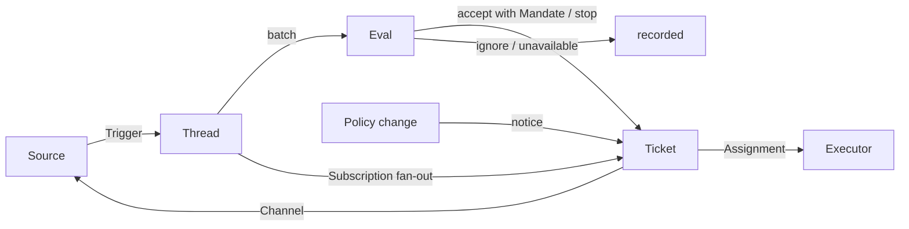

# 001 领域模型

本文命名 dsh-superagent 的概念及各自维护的规则。代码、智能体调用的工具、面板和其他文档均使用这些术语，不使用其他术语。遵循 [000 理念](000-philosophy.md)，模型只保留工作需要的概念，业务需求成为其中某个概念的属性。

## 流程

工作从 Trigger 经 Eval 进入执行。Source 产生 Trigger；Trigger 作为上下文扇出到订阅其 Thread 的 Ticket。通过这种方式到达 Ticket 的人类消息由该 Ticket 处理；其他 Trigger 进入 Eval，判断是否请求新工作。Eval 接受时，创建带 Mandate 的 Ticket。Assignment 将 Ticket 交给 Executor，结果通过 Channel 返回 Source。

## 概念

Source、Thread、Eval、Mandate 和 Subscription 构成核心领域；其他概念为其提供支持。

| 概念 | 定义 | 维护的规则 | 存在原因 |
| --- | --- | --- | --- |
| Source（来源） | 事件流。Source kind 是可复用实现；Source instance 是某个 kind 的一份配置，决定是否运行及监听什么 | 保存读取位置和自身机器人身份；定义事件，包括随时间才成立的条件。进入领域前丢弃机器人自己的消息和监听范围外的 Trigger；将每个 Trigger 转换为所属 Thread 及回复所用 Channel 地址 | 重启不能重放事件 |
| Trigger（触发） | 带来源自身元数据（如行为者）的一个不可变事件 | 属于一个或多个 Thread；同一 Trigger 接受两次也只创建一个 Ticket | 审计和幂等单位 |
| Thread（线程） | 按时间排序的 Trigger，由 Source 定义哪些 Trigger 构成一个 Thread | 同时最多运行一个 Eval；可有多个 Ticket；持有 Subscription、正在运行的 Eval 和 Decision 历史 | 为 Eval 提供一致视图及上下文 |
| Correlation（关联） | 属于同一 Trigger 的各 Thread 之间的关系 | 只补充上下文，绝不路由 | 让 Eval 能追踪相关证据 |
| Channel（渠道） | Thread 的写入侧，地址由 Source 定义 | 一个 Thread 可有多个 Channel；Ticket 持有一组 Channel | 确认、回复、拉取请求和解决评审都是写操作 |
| Policy（策略） | 版本化的研判规则及各 Source 的策略部分：谁可从该 Source 发起工作、名单如何同步以及哪些机器人可产生候选；身份使用各来源自身的标识 | 版本覆盖规则、接受模式和各来源部分。与活跃 Ticket 相关的变更（例如接单所依据的规则变化）会送达其 Assignment，但不撤销 Mandate。不同 Source 的身份绝不互相映射 | 规则改变时必须丢弃正在运行的 Eval |
| Eval（评估） | 对一批 Trigger 的判断，分为准入和研判两层 | 输入为 Trigger 批次、Thread 快照、该 Thread 的全部 Ticket（包括已结束的）和当前 Policy；输出为 Decision；不持有状态 | 决定是否开始、继续或停止新工作 |
| Mandate（授权） | 接受所授予的内容：Policy 版本、范围、强度、匹配规则、发送者在该来源的身份及来源接收 Trigger 的方式 | 不可变；更大的范围需要新 Ticket。Ticket 结束不终止它：只有人的停止操作会撤回，Policy 不再认可时会撤销。已结束 Ticket 恢复前须重新验证 | 说明为何允许工作及工作范围 |
| Ticket（工单） | 一项获授权的工作 | 只由 Eval 创建；引用 Mandate，持有 Channel 和 Input。可从打开到结束，并在人对其 Thread 发消息时重新打开，除非被人停止。其状态独立于 Executor | 拥有执行及其报告 |
| Assignment（派工） | Ticket 与某个 Executor 实例的绑定 | 一个 Ticket 随时间可有多个 Assignment；独立于 Ticket 从 pending → running → ended；Executor 一侧只有最终报告可结束 Ticket | Executor 在领域之外，但执行者必须纳入领域 |
| Subscription（订阅） | Ticket 与 Thread 的多对多关系，由 Thread 持有 | 匹配 Trigger 不检查发送者即扇出给所有活跃订阅 Ticket；以此送达 Ticket 的人类消息不经 Eval。仅供上下文的关注同样发送消息，但不授予后续消息强度、不恢复 Ticket。已结束 Ticket 保留订阅，包括已关闭或合并的拉取请求：人的消息在同一 Mandate 下无需 Eval 或 Decision 即可恢复；机器人和 CI 消息不会送达，因为 Executor 恢复时会重新读取 Thread。被人停止的 Ticket 不接收任何消息。主 Session 只有在消息明确指向已有 Ticket 时才附加 Thread。人可移除某 Thread 的全部订阅；Executor 只能移除自己发现无关的附加 Thread 订阅，Ticket 起源 Thread 及 Source 令其关注的 Thread（如其拉取请求）除外 | 后续讨论无需再次提及智能体即可送达 Executor |

人不是领域概念。Trigger 携带 Source 提供的行为者标识。允许名单属于 Source 的 Policy 部分，使用该 Source 的身份。一个人在多个 Source 上的账号对应关系属于智能体需要时读取的提示词文本。

带有 Session 和目录的 Executor 位于领域之外，通过 Assignment 接入。

聚合：Source 持有读取位置。Thread 持有 Subscription、正在运行的 Eval（串行运行，期间到达的 Trigger 合并为下一批）及 Decision 历史。Ticket 持有 Assignment、Channel 和 Input，并通过 id 引用 Decision。

## 不采用的概念

| 不采用 | 原因 |
| --- | --- |
| 将 Principal 或 Membership 作为实体，或映射跨 Source 身份 | 人是 Trigger 元数据；允许名单属于 Source 的 Policy；跨来源映射属于提示词文本 |
| Eval 自己调度延迟 Trigger | 需要等待的条件属于普通 Source，因此 Eval 不依赖 Source |
| Eval 的等待或撤销状态 | 等待属于 Source；超时 Eval 将 Trigger 重新排队，或以 `unavailable` 结束 |
| 一个 Thread 最多一个活跃 Ticket | 一个 Thread 可以承载多个独立工作；研判利用 Ticket 列表避免重复 |
| “追加到 Ticket”的 Decision | 追加属于 Subscription 扇出，不需要 Eval |
| 对 Subscription 做准入检查 | Subscription 覆盖整个 Thread；Mandate 将授权与上下文分离 |
| 由 Correlation 路由 | Subscription 负责路由；Correlation 只补充上下文 |
| Ticket 状态跟随 DSH Session | Ticket 可以交接、恢复或由多个 Executor 执行，因此自定义状态 |
| Executor 宣称人要求停止 | 只有 Eval 决定结束的强度 |
| Policy 变更时取消运行中的 Ticket | 取消会留下半成品；应记录并传达变更 |
| Executor 失败或受阻时锁定其 Session 的所有工具 | 这会拒绝直接在 Session 中工作的人以及恢复后的报告；暂停自动输入即可 |
| 从报告的自由文本推断“等待人工” | 分类需要结构化事实；Executor 通过结构化字段提问 |

## 可复用部分

上述概念及规则可复用。Source 实现、Policy 内容、Executor 和 Channel 实现属于具体部署。各 Source 在内部保留自己的术语，如消息、聊天或通知，并将其转换为 Trigger。

| 部分 | 本仓库中的实现 |
| --- | --- |
| Source | 飞书：实时事件、历史恢复、订阅话题轮询。GitHub：通知、已订阅 Issue 和拉取请求、CI 变化、拉取请求合并或关闭；启用时还包括仓库中新建的全部 Issue、拉取请求和评论，以及默认分支 CI |
| Policy | 研判规则，以及各 Source 的允许名单、同步、机器人名单和准入表 |
| Executor | 每个 Ticket 一个 DSH Executor Session 和一个目录，使用由 Executor 和 Source 注册变量的执行环境 |
| Channel | 飞书话题回复、GitHub 评论和评审线程回复 |

## 术语表

下表汇总本文及后续文档的术语和中文名称；尚未在上文介绍的术语将在后续文档解释。面板一次显示一种语言，点击 (?) 可打开中英双语术语表。智能体发送到 GitHub 和飞书的消息使用通俗语言，而非这些术语。

| 术语 | 中文 | 含义 |
| --- | --- | --- |
| Agent | 智能体 | dsh-superagent 运行的自动化团队成员，通过 GitHub 账号或飞书机器人等身份在 Source 上行动 |
| Main Session | 主 Session | 评估 Trigger、接受和派发 Ticket、回复的 DSH Session；在代码和提示词中称为 `orchestrator` |
| Executor Session | 执行器 Session | Executor 为一个 Ticket 运行的 DSH Session；在代码和提示词中称为 `worker` |
| Source | 来源 | 事件流：插件提供的 kind 加一份实例配置 |
| Trigger | 触发 | 来源产生的一个不可变事件 |
| Thread | 线程 | 按时间排序的 Trigger；Eval 在其中依次运行 |
| Correlation | 关联 | 共享某个 Trigger 的 Thread 之间的关系，只增加上下文 |
| Channel | 渠道 | Thread 的写入侧 |
| Policy | 策略 | 接受工作的版本化规则及各 Source 的策略部分，例如谁可在那里请求工作 |
| Policy version | 策略版本 | 规则、Source 部分和接受模式某个组合的标识；每个 Mandate 均记录它 |
| Eval | 评估 | 将一批 Trigger 转化为 Decision 的过程 |
| Gate | 准入 | Eval 的确定性第一层：谁可以发起工作，以及以何种强度发起 |
| Assessment | 研判 | Eval 期间模型作出的判断 |
| Decision | 决定 | Eval 的结果 |
| Mandate | 授权 | 接受授予的内容：强度、范围及所依据的 Policy 版本 |
| Ticket | 工单 | 一项获授权的工作 |
| Assignment | 派工 | Ticket 与一个 Executor 实例的绑定 |
| Subscription | 订阅 | Ticket 与 Thread 的关系 |
| Fan-out | 扇出 | 将订阅 Thread 的 Trigger 作为上下文送达 Ticket |
| Executor | 执行器 | 运行 Assignment 的端口：每个 Ticket 一个 Executor Session 和一个目录 |
| Execution environment | 执行环境 | Executor Session 和准备命令运行的位置：Executor 和 Source 注册的变量，每项包含键、值和描述 |
| Report | 报告 | Assignment 向其 Ticket 报告的状态 |
| Attention | 待人工决定 | Ticket 上等待人回答的问题 |
| Disposition | 去向 | Trigger 被过滤、评估或扇出的记录 |
| Input | 输入 | 送达 Ticket 的上下文：扇出的 Trigger、Policy 变化、恢复和文本 |
| Scope | 范围 | Mandate 允许的工作 |
| Strength | 强度 | Mandate 或 Eval 的依据有多强 |

| 分组 | 值 |
| --- | --- |
| Decision | accept 接单 · stop 停止 · ignore 忽略 · unavailable 未完成 |
| Strength | explicit 明确 · inferred 推断 |
| Assignment | pending 待启动 · running 执行中 · ended 已结束 |
| Report | progress 进展 · waiting 等待 · ready 就绪 · blocked 受阻 · failed 失败 · dropped 无需处理 |
