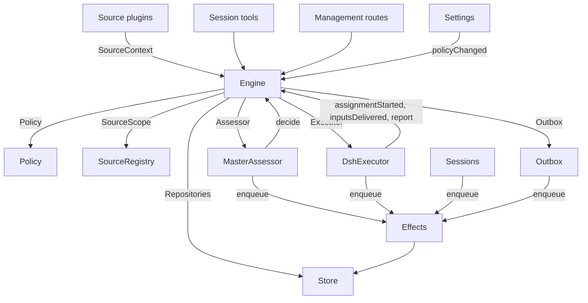

# 007 架构

这是面向开发者的实现指南，将 [001 领域模型](001-domain.md)至 [006 部署](006-deployment.md)中的概念映射到类、接口和文件。建议先阅读 Runtime 和 Engine，再以模块和测试表作为代码索引。

## 核心类和适配层

核心类通过小型接口拥有领域概念和外部边界。适配层将工具参数、HTTP 请求、Source 载荷和 DeepSeek Harness 事件转换为对这些类的调用，再将结果转换为卡片、视图和消息。

`Runtime`（`src/app/runtime.ts`）构造应用、提供依赖并负责启动和关闭。`Engine` 构造自己的内部组件。Executor 和 Assessor 会回调 Engine，因此 Runtime 向它们提供 getter，而不是要求循环构造顺序。

### Runtime

`Runtime` 是组合根，不包含领域规则。其构造函数锁定状态目录、打开 Store 并构造各组件。构造失败时关闭 Store 并释放锁。

启动时注册管理路由并运行 Setup。设置完成后，安装 Session 和 Executor 钩子、确保主 Session 存在、启动 Policy 同步、恢复中断的 Assignment，然后启动 pass 和 effect。`ready` 标志启动完成。

关闭时取消轮次，等待 pass、effect 和智能体，恢复进程环境，关闭 Store 并释放锁。Source 插件通过窄接口 `SourceHost` 将 Runtime 作为 `orchestrator` 服务注入。

| 组件 | 模块 | 职责 |
| --- | --- | --- |
| Setup | `src/app/setup.ts` | 按 Worker shell 的运行方式探测 CLI，解析仓库和账号；写入并应用 Worker 环境和命令 shim，保存设置问题；Settings 通过它检查更改后的账号并重启，再次运行设置 |
| Passes | `src/app/passes.ts` | 每次只执行一个 pass，每两秒及命令请求时运行：先执行到期 effect，再执行 `Engine.evaluateDue`；Source 的 Trigger 通过它到达 Engine |
| Outbox | `src/app/outbox.ts` | Engine 的 `Outbox` 端口，也是回执的唯一写入者：`send` 在一个事务中保存消息回执并将其 `reply` effect 入队，处理器通过 `SourceRegistry.send` 发送；Source 关闭时消息等待，对话消失或不再监听时丢弃 |
| Notices | `src/app/notices.ts` | 将领域事件和 Worker 活动转换为主 Session 消息。`eventNotice` 处理领域通知；`reportRelay` 立即转发问题，将普通进展留在 Ticket 上，并转发其他报告；`followupRelay` 指出拥有人类后续消息的 Ticket。轮次中到达的转发在下一步通过 DeepSeek Harness 收件箱一起送达 |

### Engine

`Engine`（`src/core/engine.ts`）是 Trigger、Thread、Decision、Ticket 和 Assignment 的唯一写入者。它接收 `src/core/ports.ts` 中的端口：`Repositories`、当前 Policy 的 getter、`SourceScope`、`Assessor`、`Executor` 和 `Outbox`。可选依赖为 `prepareTicket`、`now` 和 `emit`。

所有 Engine 方法均同步。每条命令在一个事务中修改聚合。`evaluateDue` 对每个修改的 Eval 或 Ticket 使用独立事务。端口在事务内将外部工作入队，适配器在提交后执行。无效请求抛出 `UserError`。

Engine 暴露一个入口并委托给五个内部组件。它负责每条命令的事务。跨组件命令（如 `attach`、`evaluateDue`、`policyChanged`）依次调用各组件。

各组件均继承 `EnginePart`（`src/core/part.ts`），由其提供选项和共享读取。组件之间的依赖单向流动：

| 组件 | 职责 | 依赖 |
| --- | --- | --- |
| `Intake` | 处理 Source 的 Trigger：连同去向只保存一次、记录在所属 Thread 和关联上、扇出到订阅 Ticket；除非它是已到达 Ticket 的人类消息，否则在主要 Thread 上为 Eval 排队 | Tickets |
| `Evals` | Thread 的 Eval：批处理、准入强度、行为者及依据和赋予它们的 Trigger（`primary`）、候选送达后的截止时间及暂停造成的偏移、超时 Eval 重排、候选、重放和交回、Policy 变化时重排，以及每次结束的 Decision：accept、stop、ignore 或 unavailable | Tickets |
| `Tickets` | Ticket 生命周期：根据接受创建 Ticket、Mandate、Subscription 和首个 Assignment；其关注的 Thread 及关闭（`followsDone`）、附加及仅供上下文关注的 Thread、Input 和备注、恢复及其拒绝的消息、重试、重启、停止和结束、移除的 Subscription，以及向受影响 Ticket 通知 Policy 变化 | Replies |
| `Assignments` | Executor 和 Worker 报告的事实：Assignment 已启动、Input 已送达或发送失败、重启中断及含人类问题的 Worker Report | Tickets、Replies |
| `Replies` | 通过 `Outbox` 写入 Channel：依照各自规则发送确认、答复、结果和待关注消息 | 无 |

命令使用祈使式名称，例如 `stopTicket`；适配器报告的事实使用过去式名称，例如 `assignmentStarted`。查询 `candidate` 使用名词。

调用方只收到其角色对应的 Engine `Pick`：`EngineForSources`、`EngineForMainSession`、`EngineForPeople`、`EngineForSettings` 或 `EngineForExecutor`。

| 角色 | 方法 | 效果 |
| --- | --- | --- |
| Sources | `receive(trigger)` | 将 Trigger 保存一次并返回 `stored`、`duplicate`，或在没有 Source 接收时返回 `filtered`；将其扇出到订阅其 Thread 的 Ticket，其中人的消息会立即恢复已结束 Ticket，除非处理已暂停；然后在主要 Thread 上为 Eval 排队，除非它是到达 Ticket 的人类消息，此时由该 Ticket 处理 |
| Sources | `bindThread(ticketId, thread, own)` | 使打开的 Ticket 关注 Source 的一个 Thread，如拉取请求；Ticket 创建该 Thread 时为 `own`；再次绑定已关闭 Thread 会重新打开它。Thread 的关闭而非 `ready` Report 结束 Ticket |
| Sources | `threadClosed(thread, outcome, at)` | Thread 关闭：关注它的每个打开 Ticket 记录关闭，并在完成其关注的 Thread 后结束（`followsDone`）：它创建的 Thread 均已关闭，或未创建时所有关注的 Thread 均已关闭。结束结果与最后一次关闭相同，为 `merged` 或 `closed`；但关闭后恢复的工作尚未报告 `ready`，或 Executor 在其最新非 `progress` Report 或最后一次轮次结束后，通过确认或回答接手其负责的人类后续消息时须等待；此时 `dropped` Report 按关闭结果结束 Ticket |
| Main Session | `candidate(triggerId)` | 研判者所见的、持有该 Trigger 的 Eval |
| Main Session | `candidateDelivered(evalId)` | Eval 候选已到达主 Session，截止时间从此刻计算 |
| Main Session | `decide(triggerId, outcome)` | 记录 Eval Decision，或明确请求的直接 Decision。接受操作原子地创建 Ticket、Mandate、Assignment、Subscription 和确认。从卡片忽略推断候选时，在给定原因前记录 `ignoredFromCard`。`followupOwners` 仍拥有人类后续消息时，只允许停止 |
| Main Session | `attach(ticketId, triggerId, note?)` | 将 Trigger 路由至它指向的 Ticket，其 Executor 将其作为后续消息决定，并结束持有它的 Eval；该批次其他 Trigger 等待新的 Eval。已结束 Ticket 在其 Mandate 下立即恢复，除非处理暂停。仍由 Executor 决定的后续消息会被拒绝；路由回曾交回它的 Ticket 也被拒绝 |
| Main Session | `requestStatus(ticketId)` | 询问等待中的 Executor Session 的状态，并返回是否已询问 |
| Main Session | `note(ticketId, text)` | 以文本 Input 向 Ticket 的 Executor 提供其他工作的事实，不授予任何权限 |
| Main Session, Executor | `reply(request)` | 按消息用途将其入队到对应 Channel：`acknowledgement`、`answer`、`result` 或 `attention` |
| People | `stopTicket(ticketId, reason?)` | 人的停止操作，撤回 Mandate |
| People | `retryTicket(ticketId)` | 结束因 `failed` 或 `blocked` Report 等待人工，或 Input 发送失败（`canRetry`）的 Ticket 上停滞的 Assignment，并启动新 Assignment |
| People | `reevaluate(triggerId)` | 将已保存 Trigger 排入新的 Eval |
| People | `unsubscribe(thread)` | 移除 Thread 的全部 Subscription，关注它的 Ticket 不再关注；各 Ticket 仍决定之前在该处收到的后续消息 |
| People | `dismiss(decisionId)` | 忽略 `unavailable` Decision 显示的问题，记录在 Decision 中 |
| Executor | `assignmentStarted(ticketId, assignmentId)` | Assignment 运行，等待的 Input 开始发送 |
| Executor | `inputsDelivered(ticketId, assignmentId, inputIds)` | Input 到达 Assignment 的 Executor Session，各自等待步骤接收 |
| Executor | `inputsRead(ticketId, inputIds)` | Executor Session 将承载这些 Input 的消息纳入历史（`user/message` Session 事件），模型从中获得消息；步骤领取消息后在纳入前取消或失败不算。之后发生 Report 或轮次结束时各消息算已读，重启后亦然；Ticket 结束不会释放它。读取记录功能出现前发送的 Input，在发送后发生 Report 或轮次结束时算已读 |
| Executor | `turnEnded(ticketId, assignmentId)` | Executor Session 轮次结束，包括 Report 之后，在没有后台工作或交接给人时触发。步骤此前接收的内容算已读（`inputsRead`） |
| Executor | `deliveryFailed(ticketId, assignmentId, error)` | Input 发送失败；Ticket 显示该问题，直到发送成功、新 Assignment 启动或 Ticket 结束 |
| Executor | `report(ticketId, report)` | 记录 Report 及其面向人的问题；`dropped` 结束 Ticket；`ready` 完成未关注 Thread 的 Ticket，并按 Thread 结束结果结束已完成所关注 Thread 的 Ticket |
| Executor | `markUnrelated(ticketId, thread, reason)` | 只移除该 Ticket 对被发现无关的附加 Thread 的 Subscription，并连同原因交回其中由 Ticket 决定的后续消息 |
| Executor | `followForContext(ticketId, thread)` | 让打开的 Ticket 订阅相关 Thread 以获取上下文：消息到达 Ticket，但不授予后续消息强度，也不恢复 Ticket |
| Executor | `handback(ticketId, triggerId, reason)` | 记录 Ticket 交回已到达的 Trigger 及候选携带的原因；若该 Ticket 原本负责，在没有其他 Ticket 决定后为新 Eval 排队，并返回是否入队。每个 Trigger 只交回一次，保留 Subscription |
| Executor | `assignmentInterrupted(ticketId, assignmentId)` | 宿主停止时 Assignment 正在运行：工作中被中断，或最新 Report 之后收到 Input 的 Assignment 带恢复说明及已送达但 Executor Session 未接收的 Input 重新启动，类似重试；此后已有 Report 的保留其 Session。DshExecutor 启动时通过 `resume` 逐一报告，最早 Ticket 优先，并重新排队等待的启动 |
| Passes | `evaluateDue()` | 未暂停时：为有等待 Trigger 的 Thread 启动 Eval，每个 Thread 一个，期间排队的 Trigger 组成一批；超时 Eval 的 Trigger 连续重新排队两次，第三次记录 `unavailable`；若 Mandate 仍有效，恢复暂停期间收到人类消息的已结束 Ticket。候选尚未到达主 Session 的 Eval 不会超时。暂停期间没有 Eval 超时，恢复后截止时间按暂停时长顺延 |
| Settings | `policyChanged(from, to, effects)` | 告知每个受影响的活跃 Ticket 变化方式（`src/policy.ts` 中的 `policyEffects`：接单依据规则改变或不再适用、请求者可能不再能发起工作，或不再接受主动工作），并按新版本重新启动进行中的 Eval |

Engine 将批处理、授权、扇出、恢复和待关注生命周期规则保持为私有。多个共享谓词确保这些规则一致：

- `waitsForPerson`（`src/core/model.ts`）：最新 Assignment 报告 `blocked` 或 `failed`，此后没有人类消息到达。此条件为真时自动 Input 和失败启动继续等待。
- `followupOwners`：仍负责其自身 Thread 上收到的人类后续消息的 Ticket。Ticket 可以活跃，也可以未经人停止而结束并等待恢复。交回消息会结束该责任。
- `settled`：某个 Decision 解决了请求；stop、unavailable、routed 和被拒绝的 stop Decision 不算。
- `ticketStage`（`src/core/stage.ts`）：实现 [003 执行](003-execution.md)中的阶段表。

Ticket 结束时，未读后续消息返回 Eval，除非其他 Ticket 仍拥有它们，或其他去向已解决它们。已确认、已回答和已交回消息除外。旧记录没有确认去向时，由 outbox 回执提供该事实。最终 Report 也覆盖 Assignment 开始时等待的消息，包括恢复它的消息。停止 Ticket 的消息不会自动重新评估。

变化后，Engine 发出 `src/core/ports.ts` 中 `DomainEvents` 的事件：

`trigger.received`, `eval.started`, `decision.recorded`, `ticket.created`, `ticket.resumed`, `ticket.ended`, `assignment.started`, `assignment.ended`, `thread.subscribed`, `thread.unsubscribed`, `trigger.requeued`, or `policy.changed`.

Runtime 将 `ticket.ended`、`trigger.requeued` 和 `thread.unsubscribed` 转换为通知。送达 Ticket 的人类 `trigger.received` 转为后续消息转发。Ticket 以 merged 或 closed 结束时，`pullEndNotices` 使用稳定 id 发送一条聊天通知。其他事件目前没有消费者。

### 模型

`src/core/model.ts` 保存领域类型，`src/core/stage.ts` 保存 Ticket 阶段。Decision 将原因记录为 `reason`，即 `Reason` 列表（`src/core/reasons.ts`）：每项有 `code`、`values`，对于批次中的某个 Trigger 还有 `triggerId`。

核心代码如 `timeout`、`policyChanged`、`routed` 和 `startedTicket` 位于 `REASONS`，带有智能体通过 `reasonText` 读取的英文；准入层或 Source scope 提供各自的代码，例如 `not_a_member`；`said` 携带研判者或人编写的文字。面板通过 `reason.<code>` 表述各代码，Source 过滤的 Trigger 也以相同方式记录 Source 的代码。

Ticket 的每个事实只保存一次。没有 `ended` 时它处于打开状态；`ended` 记录结束的时间、操作者、原因和结果；最近所说的内容为最新 Assignment Report（`latestReport`）；其 Executor Session 根据 Ticket 命名（`src/executor/dsh.ts` 中的 `workerSessionId`）。

字段均有类型：`origin` 包含赋予 Eval 批次强度的可准入 Trigger 及批次本身（`triggerId`、`triggerIds`）；`execution` 是 Executor 所选内容（`name`、`directory`、`assignment`）；`delivery` 是最后一次失败的 Input 发送（`error`、`at`），直到发送成功、新 Assignment 启动或 Ticket 结束；`follows` 是 Source 要求它关注的 Thread，每项为 `{thread, own, closed?}`：Ticket 创建时 `own` 为真，关闭后 `closed` 包含 `at` 和 `outcome`。只有 Tickets 写入 `follows`；GitHub Source 使用 `pullsOf` 和 `pullOf`（`src/sources/github-pull.ts`）读取拉取请求。

携带 Trigger 的 Input 记录是否由人编写，供 `waitsForPerson` 读取。Thread 还在 `context` 中列出仅为上下文关注它的订阅 Ticket，并在 `expired` 中统计其排队 Trigger 的 Eval 连续超时次数；Evaluation 记录其 `primary` Trigger 及候选 `delivered` 的时间。

Trigger 的 disposition 记录扇出或附加到达的 Ticket、人的重新排队、交回它的每个 Ticket 及原因，以及 Executor 确认或回答它的每个 Ticket。

Mandate 的 `basis`（`MandateBasis`）记录准入层如何准入其 Trigger。重新验证读取接收 `source`、`scope`、`row`，名单中的 `sender`、匹配 `rules` 和 `via`：

| `via` | 准入依据 |
| --- | --- |
| `addressed` | 允许的发送者向智能体发消息 |
| `followup` | 消息到达已有 Ticket 的 Thread |
| `admission` | 准入表单元格；`observation` 标识推断候选 |
| `bot` | 名单中的机器人产生推断候选 |

Trigger 和 Thread 的 `meta` 属于 Source，核心不解释它们。

### Policy

`src/policy.ts` 定义设置 schema、授权和研判规则。`settingsPolicy(settings, scope)` 每次使用均返回新的无状态 `Policy`：

- `version`、`paused` 和 `evalTimeoutMs` 描述当前状态。
- `gate(trigger, thread, tickets)` 返回准入强度和依据。
- `revalidate(mandate)` 检查现有 Mandate 是否仍有效。
- `admitsInferred(rules)` 仅在 auto 模式且存在启用的匹配规则时允许主动接受。

`assessmentOutcome(assessment, settings, strength)` 将模型研判转换为 Engine outcome。它要求每条启用规则都有判断、方向已确定、有匹配规则且有意图证据。在 auto 以外的模式下，推断型接受变成“本会接受”记录。

`policyEffects(tickets, old, now, scope)` 识别变化影响哪些打开的 Ticket 及其方式。`Engine.policyChanged` 只通知这些 Ticket。`policyVersion` 对规则、接受模式和 Source 的 Policy 部分（包括机器人名单）计算哈希。

### Store

`Store`（`src/app/store.ts`）拥有一个 SQLite 数据库。Runtime 在打开前获取目录锁，防止第二个进程迁移或写入同一状态。

接口按用途分组：

- **领域仓库：** `atomic`，以及 `triggers`、`threads`、`tickets`、`decisions`，每项都有 `get`、`save` 和列表查询。带索引的工作集是 `threads.active()`、`tickets.open()`、`tickets.active()` 和 `read.subscribedThreads`。
- **只读查询：** `read` 通过 `threadTriggers`、`triggerStats`、`search`、`droppedReplies` 等方法服务视图、工具和 Source 轮询。这些方法绝不写入。
- **Source 元数据：** `threads.describe` 和 `threads.patchMeta` 更新 Source 拥有的 Thread 元数据。
- **设置：** `settings`、`saveSettings`、`blockRevision` 和 `settingsHistory`。设置和提示词使用带编号的 `Versions`（`src/app/versions.ts`）。
- **Outbox 回执：** `replyStatus` 和 `receipts`，仅由 Outbox 写入。回执操作有 `get`、`waiting`、`behind`、`add`、`settle` 和 `withdraw`。`behind` 检查同一 Ticket 和对话的更早消息是否仍在等待且失败不足三次。撤回的消息以 `channelGone` 或 `channelIgnored` 结算。只读查询通过 `failingReplies`、`droppedReplies` 和 `droppedSince` 暴露失败和丢弃的回复。
- **类型化键值记录：** `get`、`set`、`delete` 和 `keys`，使用 `KV` 中的条目。

`afterCommit` 只在事务提交后运行操作，回滚后绝不运行。Runtime 以保存时的形状读取记录；schema 11 迁移在启动时转换受支持的旧记录。

### Effects

`Effects`（`src/app/effects.ts`）是持久化副作用队列。命令在其事务中调用 `enqueue(kind, key, payload)`；仅提交后开始执行。

每个 kind/key 对应一行。对相同等待键再次入队会替换 payload 并使其立即到期，不改变队列顺序。`handle(kind, run, options)` 为每个 kind 注册一个处理器。它按最早优先处理到期行，直至并发上限。

失败以指数退避重试。抛出 `Later` 会推迟工作但不计失败，例如没有空闲 Worker 槽位时。`start` 在设置完成后开始处理；`drain` 在关闭时停止并保留待处理行；`pending`/`idle` 暴露队列状态。

| 类型 | 处理器 | 职责 | 并发 | 重试 |
| --- | --- | --- | --- | --- |
| `assessment` | MasterAssessor | 将 Eval 候选卡片引导到主 Session 的轮次，然后通知 Engine 已送达，以此开始 Eval 截止时间 | 4，暂停时不运行 | 2 秒起翻倍至 60 秒 |
| `launch` | DshExecutor | 启动待处理 Assignment：准备命令、Executor Session、派工消息 | 空闲 Worker 槽位数，暂停时不运行 | 模型提供商或网络暂时性失败从 5 秒起翻倍至 300 秒，重试三次；其他失败及准备命令失败使 Ticket 失败。暂停或槽位满时 5 秒后再试 |
| `delivery` | DshExecutor | 按顺序将 Ticket 等待的 Input 交给运行中的 Assignment | 4，暂停时不运行 | 2 秒起翻倍至 60 秒；等待 Worker 槽位时 2 秒后再试 |
| `relay` | Sessions | 将 Worker 报告或问题、人的后续消息引导到主 Session 轮次 | 1，按队列顺序 | 2 秒起翻倍至 60 秒 |
| `notice` | Sessions | 向主 Session 注入通知但不唤醒 | 1，按队列顺序 | 2 秒起翻倍至 60 秒 |
| `reply` | Outbox | 通过 Source 为 Channel 发送消息；等待同一 Ticket 发往同一对话且失败不足三次的更早消息；撤回消息会取消 | 1，暂停时不运行 | 5 秒起翻倍至 300 秒；Source 关闭或等待更早消息时 5 秒后再试 |

每个 kind 以其名称拥有一个健康项。其中某个 effect 连续失败三次时报告错误，`delivery` 除外，其失败显示在 Ticket 上。转发保持顺序，通知也如此；失败项阻塞同类后续项。

### Sources

Source 通过 `src/sources/kind.ts` 定义的 `SourceKind` 扩展宿主。kind 声明其身份、标题、描述、配置 `schema` 和 `fields`、推导出的 `facts` 及 `health` 条目。可选行为包括 `scope`、`channel`（`allowed`、`send`、`link`）、`threadContext`、`find`、`policy`、`environment` 和 `refreshLabels`。

`SourceRegistry`（`registry.ts`）拥有已注册 kind 和已保存实例，并实现 Engine 的 `SourceScope`。注册在 `HealthBoard` 上声明健康项；重复声明和保留的 `sync:` 名称会被拒绝。SourceContext 只能通过其注册所声明的条目写入，因此注销后的报告无效。

注册表配置方法包括 `kind`、`instances`、`instance`、`validate`、`validatePolicy`、`policyPart`、`channelAllowed`、`declarations`、`environments`、`find` 和 `scope`。`find` 查询每个支持搜索的 kind。

通用代码通过注册表访问 Source 行为。`send(message, commands)` 调用 kind 的 Channel，返回 `sent`、`gone`，或在 kind 未安装时返回 `waiting`。`link` 解析其 Channel 链接。`threadContext` 将 kind 的读取器与配置配对；kind 没有读取器时不返回内容。无效的已保存配置会禁用实例。

插件接收 `SourceHost`：注册表和 `context(kind)`。kind 本身使用更窄的 `SourceContext`，由 `src/app/source-context.ts` 中的 `sourceContextOf` 构造。

该上下文提供部署及命令、设置就绪状态（`ready`、`configured`、`problem`）、配置、`receive`、`atomic` 和类型化 `state`。还提供 Thread 读取和元数据写入、Ticket 读取和绑定/关闭命令、Trigger 读取、通过 Outbox 的 `notify`，以及已声明健康项的 `report`。

### DshExecutor

`DshExecutor`（`src/executor/dsh.ts`）为每个 Ticket 提供一个 Session 和目录。`start` 和 `deliver` 将 `launch` 和 `delivery` effect 入队。`stop` 通过 `Store.afterCommit` 取消轮次，因此回滚的结束操作不会停止 Worker。

`prepare(ticket, outcome)` 提供 Engine 的 `prepareTicket` 钩子：短名称、目录和 `ticketExecution` 派工文本。`workerSessionId(ticket.id)` 派生 Session id。

`WorkerSlots` 在启动或唤醒空闲 Worker 的发送之前预留容量。人类消息可以使用超过 `maxWorkers` 的一个槽位，唤醒优先于启动。`activeCount` 提供面板负载。

提供商和网络的暂时性失败重试三次。启动使用 effect 退避；失败轮次在 15、30 和 60 秒后收到继续消息。`inputMessage` 根据当前 Ticket 状态渲染每个 Input，`mandateInstructions` 为推断工作添加匹配规则限制。

`install` 订阅 Session 事件；`dispose` 取消订阅。轮次结束通常报告等待，但已就绪或需要人工操作时除外。错误报告失败。启动时 `resume` 通过 `assignmentInterrupted` 报告中断的 Assignment，并重新排队不等待人的待启动项，最早 Ticket 优先。

### MasterAssessor

`MasterAssessor`（`src/app/assessment.ts`）让主 Session 研判主动候选。`request` 将 assessment effect 入队；`release` 在 Eval 结束时清除缓存状态。

其 `context`、`read` 和 `decide` 方法服务于 `orchestrator_eval`、`orchestrator_eval_read` 和 `orchestrator_eval_decide`。它们通过 `SourceRegistry.threadContext` 提供有界 Thread 上下文、仓库上下文和决定提交。没有上下文读取器的 kind 只提供 Trigger 和批次。

`assessmentOutcome` 为 `Engine.decide` 转换模型回答。Evals 再次根据当前 Policy 检查推断型接受。

### Settings

`Settings`（`src/app/settings.ts`）读写带修订号的设置块。`current` 和 `view` 读取；`save(block, value, revision, origin)` 校验保存；`pause(paused, origin)` 更改独立的 `paused` 设置。

每次保存声明来源：`panel`、`tool` 或 `sync`。只有 `panel` 可更改执行环境或 `SETUP_FIELDS`（`src/deployment.ts`）中列出的字段。

Policy 版本变化时计算 `policyEffects`，记录哪些 Ticket 已收到通知，并调用 `Engine.policyChanged`。`syncable` 和 `sync(id)` 刷新 Source 的 Policy 部分。`refreshLabels(id)` 刷新显示名称。

### Prompts

`Prompts`（`src/app/prompts.ts`）以 `Versions` 保存配置。`current`、`version` 和 `history` 读取；`validate`、`preview` 和 `save(value, baseRevision, source)` 检查并保存；`compose` 和 `skills` 构建 Session 文本。

`builtInParts` 列出覆盖键、角色、默认文本和所需模板占位符。每个覆盖项保存团队 `text` 和 `base`：原默认内容的 `builtInBase` 键。保存时将该默认内容保存在 `KV.prompts.builtIn` 下。`defaultChanged` 随后报告变化的默认内容、可获得的旧文本及已移除部分。

校验从已保存覆盖项继承省略的 base，删除已保存数据中已移除的部分，并拒绝空文本或其他未知键。这使保存工具能往返处理读到的配置。`environmentSection` 和 `policySection` 仅使用自身键替换一次模板值。没有覆盖项的配置使用默认值。

### Sessions

`Sessions`（`src/app/sessions.ts`）管理两个角色的 DeepSeek Harness Session。`ensure` 使用角色模型创建 Session。`install` 跟踪智能体事件，并为受管 Session 注册提示词、技能和工具。

`prompt` 对每个请求 id 只发送一次。`relay` 和 `notify` 将主 Session 消息入队，分别由 `relay` 和 `notice` effect 处理。`src/app/notices.ts` 定义内容；`delivery` 检查消息是否到达。

每次模型请求将 Session 绑定到当前提示词修订。使用过的修订会持久保存：`promptVersion` 标识当前修订，`mayRead` 限制 Worker 可查看的版本。每个智能体使用一个 map 跟踪注册项。

`status` 和 `promptVersion` 服务于提示词页面。保存通过 `Prompts.save` 并通知主 Session。`modelRetry` 暴露模型预算重试状态。

### 适配层

| 适配层 | 转换内容 |
| --- | --- |
| `src/app/runtime.ts` | 组合根：以各组件使用的接口构建它们，注册路由和 Source 宿主，启动和停止 dsh-superagent |
| `src/app/notices.ts` | 将领域事件和 Worker 报告转换为主 Session 通知和转发 |
| `src/app/tools/main.ts`, `src/app/tools/executor.ts` | 将主 Session 和 Executor Session 的工具参数转换为核心类调用，并将结果转为卡片 |
| `src/app/http.ts`, `src/app/views/`, `src/app/api.ts` | 将 HTTP 请求转为调用，将 Store 读取转为面板视图；`api.ts` 为面板的每条路由定义类型 |
| `src/app/resources.ts`, `src/app/links.ts`, `src/app/cards.ts` | 将资源名称转为读取、来源消息转为链接、记录转为供模型使用的紧凑卡片 |
| `src/sources/github*.ts`, `src/sources/feishu*.ts`, `src/sources/poll.ts` | 将 GitHub 和飞书载荷转为 Trigger 和 Thread 事实，将消息转为 CLI 调用 |
| `src/deployment.ts`, `src/setup.ts`, `src/infra/` | 设置探测和问题、CLI 传输、智能体进程环境 |

## 依赖规则

- **显式、窄范围的依赖。** 每个类接收一个声明所需内容的接口，大多是其他类的 `Pick` 类型：核心类使用 `ExecutorHost`、`AssessorHost`、`SessionsHost`、`SettingsHost`、`SetupHost`、`PassesHost` 和 `OutboxHost`；适配层使用 `HttpHost`、`MainToolsHost`、`ExecutorToolsHost`、`ResourceHost`、`LinkHost` 和 `SourceContextDeps`，Engine 则按调用角色提供对应 `Pick`。Runtime 只通过此类接口传递自身。Source 插件注入 `orchestrator` 服务，其类型为 `SourceHost`：注册表和 `context(kind)`；kind 的代码只看到自己的 `SourceContext`。
- **导入边界。** 除 Node 的哈希外，`src/core` 不导入自身以外的内容，也不执行 I/O。`src/sources` 不从 `src/app` 导入。面板只从宿主侧导入类型，以及 `src/admission.ts`、`src/limits.ts`、`src/setup.ts`、`src/navigation.ts`、`src/sources/host.ts`、`src/core/errors.ts`、`src/core/reasons.ts` 的普通值和 `src/app/api.ts` 的过滤列表。
- **每种状态只有一个写入者。** 其他组件只读取或请求该写入者。

  | 状态 | 写入者 |
  | --- | --- |
  | Trigger、Thread、Decision、Ticket、Assignment | Engine |
  | Source 的读取位置，以及它在 Thread 上保存的 meta（`label`、`url`、`facts` 和自身键） | 该 Source，通过 `SourceContext` |
  | 设置及其历史 | Settings |
  | 提示词版本 | Prompts |
  | Effect 行 | Effects |
  | Outbox 回执 | Outbox：Engine 消息和 Source 的 `notify` 通过其 `send` 发送，其 `reply` effect 标记回执 |
  | 健康项 | 在 `HealthBoard`（`src/infra/health.ts`）上声明它的组件，重复声明被拒绝：`runtime` 由 Runtime 声明，Passes 通过它报告；`evals` 由 Runtime 在每次 pass 后报告；`models` 由 Sessions 报告；各 effect 类型由 Effects 报告；`worker` 由 DshExecutor 报告；Source kind 的条目由 SourceRegistry 为该 kind 的 Source 报告；`sync:<id>` 由 Settings 报告 |

  Source 只能通过调用 Engine 的 `SourceContext.tickets.bindThread` 和 `threadClosed` 更改 Ticket。
- **请求与事实。** 请求操作的方法以祈使动词及对象命名，如 `stopTicket` 或 `bindThread`，可以被拒绝；记录适配器已完成事实的方法使用过去式，如 `assignmentStarted` 或 `deliveryFailed`。每个宿主按需要的角色类型接收 Engine。
- **类型化字段，Source 数据归 Source。** 代码读取 Ticket 和 Mandate 的类型化字段。Source 不在 Ticket 上保存任何内容：Ticket 关注哪些 Source Thread 由 Ticket 的 `follows` 保存，而 Source 对 Trigger 或 Thread 保存的内容位于其 `meta`。
- **固定拒绝。** 人或智能体可触发的拒绝是 `src/core/errors.ts` 中 `USER_ERRORS` 的 `UserError(code, values)`。管理 API 对 `missing` 代码返回 404，其他返回 400，面板以当前语言表述各代码。设置问题使用 `SetupError` 代码（`src/setup.ts`），固定健康文本使用 `HealthCode`（`src/sources/host.ts`），以相同方式表述。
### Source 专属依赖

部分通用模块仍直接引用 GitHub 或飞书：

- Outbox 应用飞书聊天词数限制。
- `src/app/links.ts` 解析飞书消息链接和 `repliedTo`。它和 Runtime 使用 `feishuSettings` 读取设置。
- `src/app/resources.ts` 读取 `feishu/` 和 `github/` 原始内容；`src/app/cards.ts` 使用 `pullOf` 构造 Ticket 卡片。
- Runtime 为以 merged 或 closed 结束的 Ticket 发送 `pullEndNotices`。
- Executor 工具使用 Runtime 暴露的 GitHub 上下文，通过 `readPull` 和 `claimPull` 绑定报告的拉取请求。
- MasterAssessor 使用 `readRepositoryPath` 读取仓库文件。
- Sessions 和 Prompts 只为 GitHub 和飞书注册内置技能。迁移会转换它们的 schema-10 记录。
- Setup 只探测 GitHub 和飞书账号字段（`SETUP_FIELDS`）。只有这两个 Source 通过 `SourceContext.problem` 接收账号设置问题。

## 模块

| 路径 | 职责 |
| --- | --- |
| `src/index.ts` | 主插件入口：读取机器设置、启动 Runtime，并向其提供 Source 账号保存所用的重启回调 |
| `src/deployment.ts` | 插件 `Config` 和 `Machine`；`resolveDeployment` 和 `resolveFeishuBot` 从 Source 设置读取仓库和账号，CLI 按 Executor shell 的方式运行；`SETUP_FIELDS` 列出设置流程读取的 Source 字段。代码不指定任何人、账号或组织 |
| `src/setup.ts` | 设置问题：`SetupError` 包含代码、修复位置，以及日志、主 Session 和面板共用的英文文本 |
| `src/policy.ts` | Policy：各设置块的 schema、Policy 版本、准入和 Mandate 重新验证 |
| `src/admission.ts` | 与面板共享的准入表值、每个单元格的选项和默认值 |
| `src/limits.ts` | 人所设置的值的限制，供设置 schema 校验并供面板字段使用 |
| `src/kv.ts` | `KV`：各类 `kv` 记录的键、值类型及所有者，以及 Store 和 `SourceContext.state` 接受的 `Key`、`Family` 类型 |
| `src/navigation.ts` | 宿主目录列出 DeepSeek Harness Session 后，从面板打开它 |
| `src/core/model.ts` | 领域类型，包括类型化 Ticket 和 `MandateBasis`，以及 `threadKey`、`ticketOutcome`、`reached`、`followupOwners`、`settled`、`waitsForPerson`、`liveTicket`、`runningAssignment`、`latestAssignment` 和 `latestReport` |
| `src/core/ports.ts` | 端口：`Repositories`、`Policy`、`SourceScope`、`Assessor`、`Executor`、`Outbox` 和领域事件 |
| `src/core/engine.ts` | Engine、核心入口，以及角色接口 `EngineForSources`、`EngineForMainSession`、`EngineForPeople`、`EngineForSettings` 和 `EngineForExecutor` |
| `src/core/part.ts` | Engine 组件的基类 `EnginePart` 和 `EngineOptions` |
| `src/core/intake.ts` | `Intake`：将 Source 的 Trigger 送往 Ticket；除非人类消息已到达 Ticket，否则也送往 Eval |
| `src/core/evals.ts` | `Evals`：Thread 的 Eval 及其 Decision |
| `src/core/tickets.ts` | `Tickets`：Ticket 生命周期、其关注的 Thread、Subscription 和 Input |
| `src/core/assignments.ts` | `Assignments`：Executor 事实及其 Worker 的 Report |
| `src/core/replies.ts` | `Replies`：Engine 的 Channel 写入 |
| `src/core/stage.ts` | `ticketStage` 和 `canRetry`：[003 执行](003-execution.md)中的 Ticket 阶段 |
| `src/core/errors.ts` | `UserError` 和 `USER_ERRORS` |
| `src/core/reasons.ts` | `Reason`、`REASONS` 和 `reasonText`：按代码说明核心记录 Decision 或搁置 Trigger 的原因 |
| `src/core/ids.ts` | `key`：从输入派生 id，相同输入产生相同 id |
| `src/core/memory.ts` | `MemoryRepositories`：Store 仓库的内存实现，保留 Store 的顺序和嵌套回滚，供领域测试使用 |
| `src/core/index.ts` | 核心导出 |
| `src/app/runtime.ts` | Runtime 组合根及其启动和停止 |
| `src/app/setup.ts` | Setup，以及判断保存是否更改设置流程读取字段的 `setupChanged` |
| `src/app/passes.ts` | Passes 和 pass 调度器 |
| `src/app/outbox.ts` | Outbox：Engine 的 `Outbox` 端口、回执及发送回执的 `reply` effect |
| `src/app/notices.ts` | 主 Session 的通知和转发：`eventNotice`、`reportRelay`、`resultRelay` 和 `followupRelay` |
| `src/app/store.ts` | Store 和 outbox 消息 `Receipt` |
| `src/app/store-read.ts` | `storeReads`：供视图、工具和 Source 轮询使用的 Store 只读查询，绝不写入 |
| `src/app/migration.ts` | schema 11 迁移：从 schema 10 一步升级，将每条已保存记录写成当前形状 |
| `src/app/effects.ts` | Effects |
| `src/app/versions.ts` | `Versions`：供设置和提示词使用的编号快照记录，带指向当前快照的指针 |
| `src/app/cache.ts` | `TextCache`：限制大小的内存文本缓存，优先丢弃最久未使用项 |
| `src/app/settings.ts` | Settings |
| `src/app/settings-history.ts` | `policyHistory`：各已保存设置修订及相对上一修订的变化 |
| `src/app/prompts.ts` | Prompts、团队可覆盖的内置部分 `builtInParts`，以及角色提示词部分顺序 `promptParts` |
| `src/app/context.ts` | 从 `prompts/` 读取的内置提示词文本及 Session 读取的对话记录条目 |
| `src/app/skill-files.ts` | 打包文本：将文件中每行一句合并成段落的 `promptFile` 及随包技能 |
| `src/app/sessions.ts` | Sessions |
| `src/app/delivery.ts` | `AgentDelivery`：每个请求 id 只向 DeepSeek Harness 智能体发送一次消息，恢复的 Session 也适用 |
| `src/app/retry-health.ts` | `RetryHealth`：为 `models` 健康项记录哪些 Session 等待模型预算重试 |
| `src/app/role-models.ts` | 解析 Eval 和 Executor 模型，以相应角色模型初始化新 Session |
| `src/app/assessment.ts` | MasterAssessor、研判 schema，以及 `orchestrator_eval` 返回的窗口 |
| `src/app/execution-environment.ts` | 执行环境：变量、Ticket 的值、目录根路径和提示词部分各行，由 `src/app/prompts.ts` 填入模板 |
| `src/app/source-context.ts` | `sourceContextOf`：各 Source kind 的 `SourceContext` |
| `src/app/links.ts` | `sourceLink`（Trigger 消息页面）和 `candidateCard` |
| `src/app/cards.ts` | 供模型使用的 Trigger、Ticket、Thread、Decision 紧凑卡片，Ticket 卡片状态封闭集合 `TICKET_STATES` 和 `textPage` |
| `src/app/resources.ts` | `RESOURCES` 和 `readResource`：每个角色的 `orchestrator_read` 可读取内容 |
| `src/app/tools/tool.ts` | `Tool` 类型、`readTool`（两个角色的 `orchestrator_read`）和 `AcknowledgementSchema` |
| `src/app/tools/main.ts` | 主 Session 工具 |
| `src/app/tools/executor.ts` | Executor Session 工具 |
| `src/app/http.ts` | `/orchestrator/api` 路由：同源检查、请求限制及各类失败对应的状态码 |
| `src/app/api.ts` | `Api`，包含每条路由的参数、查询、正文、响应和列表过滤器；它只导入类型，因此可打包进面板 |
| `src/app/views/text.ts` | 视图文本的两种形式：单行纯文本 `preview` 和无 HTML 的 `markdown`；`plain` 和 `readable` |
| `src/app/views/records.ts` | 视图共享的行：Trigger、Ticket、Thread、Decision 和 Channel 链接；以及单次请求读取后续消息责任方的 `ownersOf` |
| `src/app/views/tickets.ts` | 按阶段划分的 Ticket 列表、Ticket 页面、Mandate 依据事实和 Executor 负载 |
| `src/app/views/threads.ts` | Thread 列表、Thread 时间线、搜索和 Decision 列表 |
| `src/app/views/sources.ts` | Source 状态：每个实例的状态、过去一天统计，以及当天过滤和丢弃的内容 |
| `src/app/views/settings.ts` | 设置页面视图：各配置块及修订、各 Source 设置及其 kind 表单，以及执行环境 |
| `src/app/views/overview.ts` | 概览：需要人的 Ticket、问题、过去一天的流转和 Executor 负载 |
| `src/executor/dsh.ts` | DshExecutor、`WorkerSlots`、`ticketExecution`、`inputMessage` 和 `mandateInstructions` |
| `src/executor/background.ts` | Worker 在 DeepSeek Harness 中的后台工作、Session 拥有的 shell 任务（`ctx.jobs`）和子智能体（`ctx.subagents`）：`runningJobs`、`untilQuiet`、`killJobs`、`collectJobs`、`stopSubagents`、`stopBackground`、`until`，以及因停止子智能体而被取消轮次的 Worker 集合 `cancelled` |
| `src/infra/commands.ts` | CLI 传输 `Commands`：`run`；限定在配置仓库并经过校验的 `api`、`pages`；以机器人身份运行的 `lark`；`git`。`CliError` 携带命令输出报告的代码，如 GitHub HTTP 状态；无输出的命令以其结束方式报错，绝不暴露参数；`validItems` 跳过并统计列表中的格式错误项 |
| `src/infra/environment.ts` | 智能体进程环境：命令 shim、git 配置和凭据助手、`runAsWorker`，以及环境和 Ticket 目录检查 |
| `src/infra/paths.ts` | 包根目录，即打包文件所在位置 |
| `src/infra/text.ts` | 词数和聊天消息上限、`fill` 和 `sameName` |
| `src/infra/health.ts` | `HealthBoard`，各组件的健康项，每项由唯一写入者声明 |
| `src/sources/kind.ts` | `SourceKind` 协议 |
| `src/sources/registry.ts` | `SourceRegistry` |
| `src/sources/host.ts` | `SourceHost`、`SourceContext`、`Health`、`health` 和固定健康文本 |
| `src/sources/poll.ts` | GitHub 和飞书轮询的共享部分：`POLL_HORIZON_MS`、`polled`、`cursorAt` 和 `pollThreads`，后者将失败作为 `pollError` 保存在 Thread 上 |
| `src/sources/github.ts` | GitHub kind 和插件入口，导出为 `./github-watch`：每轮轮询通知、打开 Ticket 的拉取请求及其 CI、已订阅 Thread |
| `src/sources/github-trigger.ts` | 将 GitHub 评论、评审、Issue 正文和 CI 变化转换为 Trigger，以及 GitHub 地址 |
| `src/sources/github-pull.ts` | 拉取请求规则：Ticket 关注哪些拉取请求（`claimPull`、`observePull`）、向 Engine 报告的关闭，以及 Ticket 以 merged 或 closed 结束时的聊天通知 `pullEndNotices` |
| `src/sources/github-channel.ts` | GitHub Channel：评论和评审线程回复，返回 `sent` 或 `gone` |
| `src/sources/github-read.ts` | CI 快照、仓库读取、`github/` 资源和 `githubThreadContext`：按页读取 Issue 或拉取请求对话 |
| `src/sources/feishu.ts` | 飞书 kind 和插件入口，导出为 `./feishu-watch` |
| `src/sources/feishu-trigger.ts` | 按同一规则将实时事件、历史页面和话题页面的飞书消息转换为 Trigger |
| `src/sources/feishu-loops.ts` | 飞书循环：事件消费者、历史恢复、群名称及订阅话题轮询 |
| `src/sources/feishu-channel.ts` | 飞书 Channel：话题回复，返回 `sent` 或 `gone` |
| `src/sources/feishu-read.ts` | 通过 `feishu/` 读取 Trigger 消息、根消息、父消息和话题，以及将其连同图片提供给研判的 `feishuThreadContext` |
| `src/sources/admission-context.ts` | 研判开始时的有界窗口：通过 kind 读取的 Trigger Thread 前几页及 Trigger 周围消息 |
| `src/sources/feishu-image.ts` | 将飞书消息图片作为附件提供给研判 Session |
| `src/client/index.tsx` | 客户端插件入口：侧边栏入口、主面板及 DeepSeek Harness 插件管理器中的页面 |
| `src/client/app.tsx` | 面板：页头、搜索、术语表、标签页和当前路由页面 |
| `src/client/provider.tsx` | 每个页面从宿主读取的内容：文案、调用、导航、通知、状态轮询和 `restart`，后者在 dsh-superagent 重启时快速读取状态 |
| `src/client/api.ts` | 管理 API 的调用和轮询，由 `src/app/api.ts` 定义类型，以及 Eval 状态的 Decision 过滤器 |
| `src/client/route.ts` | 标签页、设置分组、`parseRoute` 读取的类型化路由，以及记录上次打开设置分组的路由记忆 |
| `src/client/overview.tsx` | 概览 |
| `src/client/source.tsx`, `trigger.tsx`, `eval.tsx`, `execution.tsx` | 每个阶段一个文件：状态及存在时的设置 |
| `src/client/thread.tsx`, `ticket.tsx` | 记录页面：含时间线的 Thread，以及含授权、Input 和 Assignment 的 Ticket |
| `src/client/settings.tsx` | 设置标签页：分组导航和当前显示的分组 |
| `src/client/settings-kit.tsx` | 设置块的基础构件：阶段分组共享的设置、`useBlockDraft`、字段（包括 Source kind 的字段）和保存历史 |
| `src/client/prompts.tsx` | 提示词设置：页面拥有所读取视图，编辑器拥有草稿，编辑、完整提示词和历史标签据此渲染；内置部分编辑器显示变化的默认值，并保留或删除覆盖项 |
| `src/client/prompt-config.ts` | 以纯函数按团队部分、技能名称、内置部分（`part/<key>`，带 `withOverride`）和提示词视图提供的部分标题组织提示词配置，以及完整提示词的逐行 diff |
| `src/client/deployment.tsx` | 部署设置，也显示在 DeepSeek Harness 插件管理器中 |
| `src/client/draft.tsx` | 设置草稿：`draftReducer`、其状态及与较新保存修订的合并、保存栏文本 `saveBarText` 和保存栏 |
| `src/client/controls.tsx` | DeepSeek Harness 控件的本地副本，遵循其标记、键盘行为和设计令牌，因为 bundle 不导入 `@deepseek-ai/dsh-client-ui-primitives`；不读取上下文 |
| `src/client/widgets.tsx` | 页面共享、读取面板上下文的小组件：区块、页头、加载状态、时间、链接、确认操作、设置检查和 Markdown |
| `src/client/rows.tsx` | 页面共享的行：Ticket、Thread、Decision、Thread 标签，以及连续自动消息的折叠 |
| `src/client/markdown.ts` | 报告和问题的 Markdown 子集及消息中的裸地址，作为块和内联部分处理 |
| `src/client/text.ts` | 按键获取的文案，以及领域值、原因、发送者和时间的表述 |
| `src/client/marks.ts` | 视图所分类状态的标记：Ticket 或 Thread 阶段、Source 状态和 Decision 结果，各自有圆点、图标、色调和标签 |
| `src/client/locales.ts` | 两种语言的全部文案，以及 [001 领域模型](001-domain.md)中的术语表 |
| `src/client/client.css`, `css.d.ts` | 面板样式表，以文本加载 |

`src/sources/github.ts` 和 `src/sources/feishu.ts` 也是两个 Source 插件的入口，由 `tsdown.config.ts` 构建，并在 `package.json` 中导出为 `./github-watch` 和 `./feishu-watch`。bundle 的 `cordis.patch.yml` 插入三个插件，其中飞书禁用。

## 测试

| 测试 | 覆盖范围 |
| --- | --- |
| `tests/core-engine.spec.ts` | 内存仓库上的领域规则：接收、Eval、扇出、恢复和停止、中断的 Assignment、暂停、Policy 变化、报告和结果、附加、回复、发送失败和已忽略问题 |
| `tests/stage.spec.ts` | 逐行测试 Ticket 阶段 |
| `tests/policy.spec.ts` | Source 范围、准入层、准入表、Mandate 重新验证、Policy 版本、设置迁移和研判结果 |
| `tests/registry.spec.ts` | `SourceRegistry`：实例、校验、Policy 部分、Channel 和 Thread 上下文 |
| `tests/sources.spec.ts` | `SourceContext` 上的飞书和 GitHub Source：转换、轮询和读取位置、拉取请求规则、健康状态 |
| `tests/commands.spec.ts` | 以部署账号执行的 CLI 调用、Channel 响应，以及限定仓库范围的 GitHub 调用 |
| `tests/feishu-read.spec.ts`, `tests/github-read.spec.ts` | 飞书和 GitHub 读取 |
| `tests/admission-context.spec.ts`, `tests/feishu-image.spec.ts` | 研判的 Thread 窗口和飞书图片读取 |
| `tests/assessment.spec.ts` | MasterAssessor 为每个 Eval 保留什么，以及何时释放 |
| `tests/background.spec.ts` | 等待 Worker 的 shell 任务和子智能体：完成后唤醒，以及宿主停止 |
| `tests/bundle-patch.spec.ts` | 按 DeepSeek Harness 的方式读取 bundle patch，以及其中定义的 Executor Session 智能体预设 |
| `tests/effects.spec.ts` | effect 队列：合并、限制、退避重试、健康状态和关闭 |
| `tests/passes.spec.ts` | Passes：一次一个、执行期间请求的 pass 合并为之后的一次，以及 pass 失败报告的运行时健康状态 |
| `tests/outbox.spec.ts` | 运行中的 Runtime 上的 Outbox：处理暂停或 Source 未安装时消息等待 |
| `tests/cache.spec.ts` | `TextCache` |
| `tests/queue.spec.ts` | Runtime 通过 effect 队列执行的工作，以及早期版本保存的内容 |
| `tests/followups.spec.ts` | 人在 Ticket Thread 上的后续消息：发给主 Session 的通知、处理它的工具、突发消息的成本；Worker 交回和上下文关注，以及主 Session 备注 |
| `tests/health.spec.ts` | 每个组件一个健康项，各自在下次成功时清除 |
| `tests/delivery.spec.ts` | `AgentDelivery` |
| `tests/retry-health.spec.ts`, `tests/role-models.spec.ts` | 模型预算重试及两个角色的模型 |
| `tests/runtime.spec.ts` | 在模拟 DeepSeek Harness 宿主上通过工具和 HTTP 测试整个应用 |
| `tests/tools.spec.ts` | Session 工具：各角色的 `orchestrator_read` 读取内容，以及其他主 Session 工具的形状和校验 |
| `tests/runtime-concurrency.spec.ts` | 重叠工作：pass 期间的 Trigger，发送和启动期间变化的 Ticket |
| `tests/http.spec.ts` | 同源和回环检查、各类失败的状态码、正文大小限制、路径参数和查询 |
| `tests/settings.spec.ts` | 与模型或账号检查竞争的设置保存、被保存操作赶超的 Policy 同步，以及暂停、同步和配置块的拒绝 |
| `tests/views.spec.ts` | 管理视图从 Store 推导的内容，如丢弃消息所属的 Thread |
| `tests/timeline.spec.ts` | Thread 分页和按时间再按 id 排序的 Trigger 邻居，所有接收 Trigger 的时间使用统一格式 |
| `tests/migration.spec.ts` | schema 11 迁移：每条已保存记录转换为当前形状，并拒绝较旧 schema |
| `tests/store.spec.ts` | SQLite 和内存中的仓库及工作集、kv 区域（`KV` 的每个键只在 `src/kv.ts` 和迁移中拼写）、设置历史和查询 |
| `tests/prompts.spec.ts` | 提示词校验、组装和版本 |
| `tests/cards.spec.ts` | 内置文本逐文件必须陈述的规则 |
| `tests/model-surface.spec.ts` | 模型读取的所有内容：工具、提示词、技能和输入，对照工具 schema、执行环境和术语表检查，并遵守各角色的大小预算 |
| `tests/deployment.spec.ts`, `tests/environment.spec.ts`, `tests/index.spec.ts` | 插件配置和设置、智能体进程环境、插件入口 |
| `tests/service-script.spec.ts` | 在模拟 `ps`、`tmux` 和 `dsh` 下测试 `scripts/dsh-superagent` |
| `tests/client.spec.tsx`, `tests/navigation.spec.ts`, `tests/controls.spec.tsx` | 客户端插件注册和轮询、Session 导航和路由记忆、本地控件，以及无循环依赖的面板导入 |
| `tests/panel-overview.spec.tsx`, `panel-source.spec.tsx`, `panel-trigger.spec.tsx`, `panel-eval.spec.tsx`, `panel-execution.spec.tsx` | 使用按路由响应的模拟管理 API 测试面板各页面 |
| `tests/panel-settings.spec.tsx`, `panel-prompts.spec.tsx`, `panel-deployment.spec.tsx`, `panel-panel.spec.tsx` | 设置分组、草稿和历史、提示词、部署页面，以及面板搜索、术语表和路由记忆 |
| `tests/draft.spec.ts`, `tests/prompt-config.spec.ts`, `tests/markdown.spec.ts`, `tests/marks.spec.ts` | 草稿状态、合并和保存栏文本；按部分组织的提示词配置及逐行 diff；Markdown 子集及链接；视图分类的每种状态标记 |
| `tests/locales.spec.ts`, `tests/styles.spec.ts` | 两种语言的文案及样式表 |
| `tests/class-docs.spec.ts` | `src` 中每个类前都有 JSDoc 块 |
| `tests/docs.spec.ts` | 编号文档只链接到更早文档、所有本地链接可解析、文档没有合并冲突标记，以及本文表格列出每个模块和测试 |

`tests/fixtures/` 保存多个测试共享的内容：`host.ts` 是模拟 DeepSeek Harness 宿主；`panel-server.ts` 和 `panel.tsx` 是模拟管理 API 及页面周围的面板；`deployment.ts` 是已解析部署；`git.ts` 是测试启动的每个 git 的环境，不指定仓库；以及 `async.ts`。

## 持久化

一个 SQLite 文件 `<stateDir>/orchestrator.sqlite`，仅由 Store 打开。

| 表 | 内容 | 写入者 |
| --- | --- | --- |
| `trigger` | 每个 Trigger，以及 Engine 接收时设置的统一 `Date#toISOString` 形式的时间 `at`，使时间可按文本比较 | Engine |
| `disposition` | 每个 Trigger 的去向：带 Source 原因代码的 `filtered`、其 Eval 和 Decision、通过扇出或附加到达的 Ticket、是否重新排队、交回它的 Ticket 及原因，以及 Executor 确认或回答它的 Ticket | Engine |
| `trigger_thread` | 每个 Trigger 所属的 Thread、时间和是否由人编写，使 Thread 的 Trigger 无须扫描全部 Trigger 即可按时间、再按 id 读取；Thread 时间线页面以 `<at>\|<id>` 游标继续，不跳过时间相同的 Trigger | Store，与每个 Trigger 一起写入 |
| `thread` | Thread：Subscription、仅为上下文关注它的 Ticket、排队 Trigger、进行中的 Eval、连续超时次数和 `meta`；生成列 `active` 在有排队 Trigger 或运行中 Eval 时设置，`subscribed` 在有 Ticket 订阅时记录其 Source | Engine；Source 写入 `meta` |
| `ticket` | Ticket 及其 Mandate、origin、execution、Assignment、Channel、Input 和关注的 Thread；生成列 `open` 在未结束时设置，`active` 在有未送达 Input 或最新 Assignment 待启动或运行时设置 | Engine |
| `decision` | 按 Thread 保存的 Decision | Engine |
| `effect` | effect 队列：每个 kind 和 key 的 payload、顺序、失败次数及最后错误、到期时间 | Effects；schema 11 迁移将早期版本为主 Session 保存的工作入队 |
| `outbox` | 按 id 保存每条 Channel 消息的回执，包括所属 Ticket 和 `status`（`pending`、`sent`、`dropped`），确保同一 id 永不重复入队；丢弃消息还保存时间和原因，以及生成列 `dropped`、其时间及原因代码。等待中的消息有保存尝试次数的 `reply` effect | Outbox |
| `kv` | 按键保存的其他所有记录 | 声明该记录的组件 |

生成列从所在行的 JSON 计算，在集合之外为空，每个生成列在其集合上都有索引，使 pass 仅读取活跃工作。Store 打开缺少某列的旧数据库时会添加该列。

`KV`（`src/kv.ts`）定义每个键值记录的所有者、键和类型。所有读写方都使用这些条目；只有迁移代码使用旧键。

| 记录 | 键或内容 |
| --- | --- |
| Schema | 当前 schema 版本 |
| 设置版本 | `settings-revision`、`settings-version:<n>`、`settings-block-revision:<block>`；快照包括来源、Policy 版本和受影响 Ticket |
| 提示词版本 | `prompt-revision`、`prompt-version:<n>` |
| 主 Session | `master-id` |
| Session 提示词历史 | `session-prompts:<session id>` |
| Source 状态 | `github-cursor:<number>` 等读取位置、PR CI 指纹和已见飞书话题消息；键以 kind 或 `thread-` 加 Thread 键开头 |
| 显示名称 | `source-labels:<source id>` |

忽略状态保存在 Decision 上。Input 文本在读取时从 Ticket 渲染，因此两者都不需要单独的键值记录。

读取缓存使用有界的内存 `TextCache` 实例，重启后丢失。Session 分页读取原始 Source 记录或提示词预览时，重启后必须从 offset 0 重新读取。接收后解析的飞书链接也以相同方式缓存；只有在当前进程生命周期中读取过链接后，才能按链接搜索到它们。

目前没有删除旧记录的机制，因此以下数据无限增长：`trigger`、`disposition` 和 `decision` 行；已结束 Ticket 及其 Thread；outbox 回执；以及 `kv` 中所有已保存设置修订、提示词版本、各 Session 工作过的提示词修订、Source 按 Thread 和 Issue 或拉取请求保存的记录。

`SCHEMA_VERSION` 只递增。新版本数据库会拒绝启动；`src/app/migration.ts` 在启动时将预发布 schema 10 数据库一次性升级，并拒绝更旧版本。

## 面向模型的接口

### 主 Session 工具

主 Session 有 14 个应用工具：

| 用途 | 工具 |
| --- | --- |
| 读取和路由 | `orchestrator_read`, `orchestrator_route` |
| 管理 Ticket | `orchestrator_ticket_retry`, `orchestrator_ticket_request_status`, `orchestrator_ticket_note` |
| 重新评估 | `orchestrator_trigger_requeue` |
| 研判主动工作 | `orchestrator_eval`, `orchestrator_eval_read`, `orchestrator_eval_decide` |
| 沟通和取消订阅 | `orchestrator_reply`, `orchestrator_thread_unsubscribe` |
| 配置 | `orchestrator_settings_save`, `orchestrator_policy_sync`, `orchestrator_prompts_save` |

`orchestrator_route` 按顺序接受 1–20 个决定。每个接受、附加、停止或忽略都作为独立 Engine 命令运行。它也允许直接从卡片忽略推断候选。`orchestrator_ticket_note` 将事实作为上下文发送，不授予权限。

保存设置时选择 `policy`、`eval`、`executor`、`pause` 或 `source`；最后一种还需指定 Source id。提示词保存传入 `preview: true` 时组装文本但不保存。

主 Session 还拥有 DeepSeek Harness 的 `skill`、`bash`、`read`、`read_image`、`job_output`、`job_list` 和 `job_kill`。避免读取代码是提示词规则，不是工具限制。

### 预设和等待限制

新主 Session 使用 `dsh-superagent-router`（`ROUTER_PRESET`）。shell 命令和任务等待在 5 秒后返回。如果 Web UI 在第一轮前选择了其他预设，`Sessions` 会恢复该预设；Worker 则恢复 `WORKER_PRESET`。

`src/app/sessions.ts` 中的 `noWait` 守卫拒绝主 Session 在命令位置调用 `sleep` 的 shell 命令、超过 30 秒的 shell `timeoutMs`，以及超过 5 秒的 `job_output` 等待。报告和任务结果自动送达，因此等待只会延迟传入候选。

使用 `standard` 的已有主 Session 也需要为前台命令和任务等待明确设置超时，否则该预设的默认值分别使步骤等待 60 秒和 30 秒。宿主通过 `presetForSession` 确定当前预设，回退到 Session 投影或头部；无法读取时假定为 `standard`。

### Executor 工具

每个 Executor 有六个应用工具：

| 工具 | 用途 |
| --- | --- |
| `orchestrator_read` | 读取自身 Ticket 可用的资源 |
| `orchestrator_ack` | 确认请求 |
| `orchestrator_report` | 报告进度或结果，按拉取请求规则绑定拉取请求 |
| `orchestrator_thread_unrelated` | 移除无关的附加 Thread，交回其拥有的后续消息并告知主 Session 原因 |
| `orchestrator_thread_follow` | 订阅相关 Thread 以获取上下文，并通知主 Session |
| `orchestrator_trigger_handback` | 将消息及候选携带的原因交回一次 |

另一个 Ticket 仍拥有消息，或该 Ticket 从未拥有消息时，交回返回 `queued: false`。例如机器人消息会独立进入 Eval。

Worker 预设在 `cordis.patch.yml` 中定义，通过 `WORKER_PRESET` 选择。`src/app/sessions.ts` 中的 `WORK_TOOLS` 保留可用的文件、搜索、shell、任务、Web、技能、待办和子智能体工具。Worker 不接收向人提问或展示、修改配置档案、在 Worker 槽位外调度工作、启动其他 Session 或向其发消息、编辑外部文档的工具。Ticket 结束后工具调用被拒绝。

### 结果形状和研判上下文

路由结果使用 `{decision?, reason, ticket?}`。`orchestrator_route` 返回 `{results}`，保留条目顺序并添加每项的 `trigger_id` 和 `kind`。无效或被拒绝的条目返回 `refused` 及原因，不会中止批次。

设置和提示词保存返回已保存配置。Policy 同步返回 Source、允许名单大小，以及 `added` 和 `removed` 名称。

`orchestrator_eval` 返回上下文而非指令。研判指令位于 `runtime/admission`（`prompts/admission.md`），规则位于 `runtime/policy`。上下文包括：

- 最多 4,000 字符的 Trigger 文本，含图片 id 和批次中的其他 Trigger。
- 最多八个 `related_tickets`，打开的排在前面，以及 `tickets_total`。
- Eval 的 `policy_version`。
- Thread 窗口：前五条消息及 Trigger 两侧各五条。消息使用 `{id, from, at, text}`，通常限制 400 字符，紧邻两侧的消息限制 1,200 字符。截断消息包含 `chars`；图片引用使用 `images`。
- 其他已加载消息作为 `{id, from, preview}` 摘要，每条 50 字符。`orchestrator_eval_read` 按 id 展开。

Ticket 卡片使用 `src/app/cards.ts` 的封闭 `TICKET_STATES` 集合：如 `person/review`、`working/queued` 的打开阶段，或结束结果。无论通过接受、研判还是 `orchestrator_ack` 提交，确认均限制 100 个词。

### 读取资源

`src/app/resources.ts` 中的 `RESOURCES` 定义资源并生成工具的 `resource` 描述。

| 资源 | 内容 |
| --- | --- |
| `tickets`, `triggers`, `threads`, `decisions` | 格式为 `{items, next_offset}` 的分页列表；活动列表按最新优先 |
| `decision/<id>` | 一个 Decision |
| `thread/<key>` | 标签、Ticket、近期 Decision 和一页 Trigger |
| `trigger/<id>` | 消息文本、被回复的 Trigger 和相邻消息，不包括 CI 运行 |
| `ticket/<id>` | 相关 id、来源批次 Trigger、Thread，以及 Assignment 和 Input 的第一页 |
| Ticket 子资源 | `/assignments`, `/inputs`, `/assignment`, `/result`, `/report/<assignment id>`, `/transcript`, `/message/<n>`, `/input/<id>` |
| `settings`, `settings/<block>` | 修订和摘要，或可直接保存的完整块 |
| `prompts`, `prompts/<revision>`, `prompts/current`, `prompts/defaults`, `prompt-preview/<id>` | 提示词配置和组装文本 |
| `models`, `models/<provider>` | 可用模型 |
| `feishu/<trigger id>/…`, `github/…` | 原始 Source 记录，见 Source 技能说明 |

Ticket Thread 中，仅为上下文关注的标记为 `context`，Source 绑定的标记为 `bound`。Assignment 页面按最新优先并包含报告预览。使用 `next_offset` 继续读取列表。`/input/<id>` 接受 Input 名称或 id。`settings` 完整包含小配置块，并汇总 Policy 和 Source 块。

Source 资源包括消息邻域、`github/pulls/<n>/thread/<comment id>` 和 `github/commits/<sha>/checks`。

原始记录的消息以统一紧凑格式 `{id, from, at, text, reply_to?, path?, line?, url?}` 读取，而不是 GitHub 或飞书原始格式。

Executor Session 只能读取自己的 Ticket、其 Thread、到达它或由其请求持有的 Trigger、它工作时使用的提示词版本及原始记录；其页面省略它无权读取对象、Decision 和其他 Ticket 的 id。

页面展示的每个 id 均可通过这些资源之一读取，因此 Session 可以从一个对象走到下一个；没有读取入口的哈希（如 Eval id 或 Policy 版本）不显示在页面上。

文本页默认 4,000 个 UTF-16 代码单元，最多 8,000；列表默认 20 项，最多 50 项。

旧版本的 `event/`、`task/` 和 `observation/` 名称仍可解析。

### 发送给 Session 的消息

以下消息被引导至主 Session 的轮次：

| 消息 | 内容 |
| --- | --- |
| Candidate | 批次 Trigger 卡片、Thread、`related_tickets`、`tickets_total`、`delivered_to`、Issue/PR 链接引用的 Ticket、`handed_back` 原因及下一步操作 |
| `follow_up` | Executor 所见的一条消息、`replies_to`、接收它的 Ticket，以及 Executor 负责决定而主 Session 只能停止工作的提醒 |
| `worker_report` | Ticket 卡片、来源 Trigger、状态和最多 600 字符的摘要；截断时包含 `chars` 和读取指针 |
| `worker_attention` | 携带问题的 Ticket 卡片 |

其他通知注入主 Session 但不唤醒它：`ticket_ended`、`settings_saved`、提示词保存、Trigger 重新排队、移除 Subscription 和上下文关注。设置通知指出块、变化路径和 `read: settings/<block>`。主 Session 自己执行的保存、重新排队、取消订阅或附加不会收到重复通知。

Worker 以内联方式接收派工和 Input。第一条消息包含标题、最多 1,500 字符的派工文本和来源 Trigger 卡片。Input 携带最多 600 字符的 Trigger 卡片及 `replies_to`，或纯 Input 文本。只有截断内容才有读取指针。

### 面板专属操作

没有工具可忽略 unavailable Decision、重新运行设置、刷新 Source 显示名称，或将 Executor 拥有的人类后续消息送往 Eval。最后一项被 `orchestrator_trigger_requeue` 有意拒绝。其他面板操作都有等价工具。

大多数内置指令位于 `prompts/*.md`，每行一句，由 `promptFile` 合并。Source 技能位于 `skills/dsh-superagent-*/SKILL.md`。工具描述和重启恢复说明等固定通知仍在代码中。研判指令只位于 `prompts/admission.md`。

`tests/model-surface.spec.ts` 检查这些表面是否发生偏差。[004 提示词](004-prompts.md)解释团队可编辑部分。

## 配置热更新

除 `stateDir` 外，每个插件配置键均可动态更新。面板的部署设置和 DeepSeek Harness 插件管理器通过 DeepSeek Harness 配置表单编辑；宿主写入 `cordis.patch.yml` 并原位更新值，dsh-superagent 在使用时读取各限制，因此更改无需重启即可生效。

保存设置时，如果更改了设置流程读取的 Source 字段（如账号 CLI），或者设置仍在等待期间保存任何内容，都会重启 dsh-superagent。DeepSeek Harness 设置服务在重启期间不提供该条目，因此 dsh-superagent 自身重启后会要求它重新读取条目，使已打开的表单再次可编辑。

## 使用真实数据审查变更

将 `DSH_HOME` 指向临时目录并在那里创建新配置档案。从备份复制数据库，禁用所有 Source，暂停处理并移除主 Session id。为 GitHub 和飞书 CLI 提供只读替身。

## 未决问题

- 信任：哪些 Trigger 字段可信，例如 Source 提供的 actor 和 Thread 成员关系；哪些不可信，例如正文和引用。
- 部署隔离：让智能体的配置档案使用自己固定版本的 DeepSeek Harness 安装，避免其他位置升级 DeepSeek Harness 导致它损坏。
